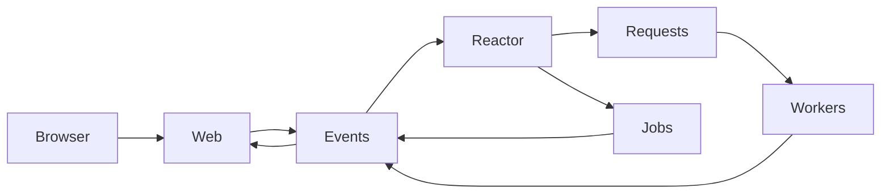

# Persistent chat runtime

Harness keeps one main chat in `HARNESS_DATA`, which defaults to
`~/.harness/chat`. Actors represent the main agent and its child agents; they are
internal execution contexts, not separate user-facing sessions. The main actor
keeps the working directory recorded when the store was created. Set
`HARNESS_DATA` to another directory when an independent chat is needed.

The runtime requires Linux, Bash 4+, `jq`, `curl`, `flock`, `setsid`, `timeout`,
`sync`, and the standard GNU filesystem/process utilities. Process leases use
`/proc` start times to distinguish a running process from a reused PID. The HTTP
frontend also requires `socat`. No Python or Node runtime is used.

## Events and projections



Committed events are authoritative:

```text
HARNESS_DATA/
  events/000000000001.json   immutable committed events
  HEAD                       highest committed sequence
  index/                     stable event-ID lookup
  state.json                 actor/request/job projection and replay cursor
  locks/                     journal, projection, request and job locks
  queue/requests/0-turn/      foreground inference requests
  queue/requests/1-summary/   memory-compaction inference requests
  queue/jobs/                ordinary tool jobs
  requests/                  immutable request inputs and completion records
  jobs/                      tool inputs, leases and completion records
  actors/                    actor memory and summary retry state
  code/                      content-addressed program snapshots
  components/                component process leases
  logs/                      component and job diagnostics
```

An event has `{seq,id,actor,kind,data,date}`. The journal lock serializes sequence
allocation and publication. Stable event IDs make resubmission idempotent;
reusing an ID with different content is rejected. If a writer stops between
event publication and updating `HEAD` or the ID index, the next writer completes
those bookkeeping updates before allocating another sequence.

The reactor holds the projection lock while consuming committed events in
sequence order and applying their effects. Its cursor advances after an event
has been applied. Derived events use deterministic IDs so replaying an event
does not create a second tool launch or observation. The persisted state records
each actor's inbox, active inference request, current turn ledger, pending jobs,
and status. Queues and completion files let components resume work independently
of the browser or command that submitted it.

Chat-visible events are messages, assistant replies, tool calls, and errors.
Request/job bookkeeping remains in the journal for recovery and diagnostics but
is excluded from chat memory. Child chats have their own actor histories; their
final reports reach the parent as `work` messages. Tool completion reaches the
owning actor as an `echo` message.

## Inference and tools

Foreground inference and memory summaries use the same bounded worker pool,
with five workers by default (`HARNESS_WORKERS`). Each worker alternates which
queue it checks first after completing a foreground request: summaries get the
next opportunity, and foreground work gets the following one. When only one
kind of work is available, the worker uses its capacity for that work. Every
request contains a complete canonical payload, provider/model selection, actor ID, and
the code snapshot that should execute it. A worker claims a request under its
lock, records its process lease, calls the provider, and publishes a completion
or failure for the reactor.

An interrupted inference can run again if it did not publish a completion. This
is at-least-once inference: a provider may have processed the earlier request
even when Harness received no response. Deterministic completion and derived
event IDs prevent that retry from committing duplicate chat actions.

Tool calls are committed as jobs before execution. Launch receipts identify the
jobs in the request's protocol artifacts, but do not trigger another model call.
Launching jobs finishes a normal turn; a completion or new user input wakes a
fresh turn. Ordinary tools run in their own process groups; subagent jobs create
child actors and return their final report to the parent.

An ordinary tool with a recorded lease and no completion is not automatically
executed again after its process disappears. It may already have changed a file
or external service. Harness reports an interrupted job with an unknown outcome
instead. This avoids an automatic second side effect; it does not guarantee that
the original side effect succeeded. Cancellation stops the relevant process
groups and removes queued work.

Program snapshots contain `bin/`, `lib/`, and `plugins/`, identified by their
content digest. Requests retain their planning generation, and tool jobs retain
its executable paths, so active work
can finish with the implementation that created it while restarted components
use newer code. Chat data and credential caches are outside these snapshots.
Local plugin executables outside the bundled program keep their resolved paths;
editing those files changes their content independently of a bundled snapshot.
HTTP dispatch loads the current transport generation. Restarting a worker retries
its unfinished immutable payload through updated transport code; an already
running HTTP process retains the generation it started with.

## Turn boundaries

At the start of a turn, Harness waits until every earlier chat message has a
built leaf summary. It renders the saved memory view through the event preceding
the first inbox message, then appends the chronological original messages from
that boundary through the current projection. This recent tail includes replies
and tool launches committed after input arrived during an active call. Indexed
actor records supply the tail without scanning the global journal or changing
the saved view. Incoming messages appear once, with historical replies and tool
launches marked as observations rather than native provider protocol messages.

Only a response stopped by an output limit receives a bounded continuation
nudge rather than being treated as complete. Its exact protocol ledger retains
assistant blocks, tool-call IDs, launch receipts, provider continuation state,
and steering that arrives between calls. Once the turn finishes, the ledger is
cleared; a later user message or job observation starts from the memory view again.

A child actor's first call also receives the parent's captured request context
before its own memory view and task. Later child turns use the child's own saved
memory. The child keeps its original steps in its own log and reports only its
final result to the parent.

Provider adapters translate this canonical ledger into Anthropic Messages,
OpenAI Chat Completions, or Responses API requests. Summaries are historical
context; they do not replace the exact tool-call/result relationship required
by a provider. Thinking may be retained as provider continuation state during
the current turn, but is not added to the durable memory tree.

## Memory log, tree, and views

Each actor owns a separate locked memory directory:

```text
actors/ACTOR/memory/
  main/YYYY-MM-DD.jsonl    append-only memory messages
  tree/YYYY-MM-DD.jsonl    append-only built summary nodes
  messages/ID.json         original-message lookup
  nodes/LEVEL-INDEX.json   built-node lookup
  sources/SEQ.json         event-to-memory-ID attribution
  ready/                  unfinished eligible summary work
  view.json               persisted chat view
  compact-view.json       persisted compactor view
  state.json              counts and unfinished batch flags
  transaction.json        interrupted mutation recovery, when present
  logged/                 completed append receipts
  raw/                    original clipped tool-result sources
```

Memory IDs start at zero and remain permanent within an actor. They are dense
append positions, independent of global event sequences. An event can produce
multiple memory messages when long text is split. Source attribution makes
ingesting the same event again a no-op. Events must be ingested in order within
each actor.

Message kinds are `user`, `unii` (assistant text), `tool`, `echo`, `work`, and
`note`. Long text is split without breaking UTF-8 characters, by a default
65,536-byte limit per stored message. Tool results are capped at 30,000
characters, including a clipping marker; the source event is retained as a raw
artifact. The original committed runtime event also remains in the journal.
Ordinary jobs retain full stdout and stderr in their job directory even when
the result delivered to the agent is clipped.

Node `(l,i)` covers `2^l` messages beginning at `i * 2^l`. A short message with
its kind label becomes its own leaf when it fits in 512 UTF-8 bytes. Two sibling
summaries are joined directly when their combined text fits; otherwise a summary
job becomes eligible after both children are built. Built nodes are immutable.
Pending work is read from the ready queue, not discovered by scanning the tree.
The scheduler can exclude already queued or retry-gated node keys before the
bounded result list is selected. Those excluded leaves still count toward the
eight-unbuilt-predecessor limit and still bound compaction context.

The chat view covers history with aligned nodes, oldest first. It is rendered
as `<chat>` lines `id+n|text`, with newlines in each summary replaced by spaces.
Original messages remain available through `zoom`; dates remain available
through `date`. Named-actor zoom resolves an actor ID or unique name and pages
through its original messages; `part` pages within a long message. A requested
foreground prefix is not rendered while a leaf in that prefix is unresolved.
A compaction context stops at the first unresolved
leaf and contains only built summaries.

Views grow by appending leaves. Once the rendered chat view exceeds 128,000
bytes, a batch merges built sibling pairs until at most 64,000 bytes remain.
Pairs are ranked by age measured from their **end**, normalized by their own
size; older pairs break ties. A batch that cannot reach its target keeps its
unfinished flag and continues when more parents become available. The separate
compactor view uses 32,000/16,000-byte thresholds and begins another batch when
the chat view merges.

Views are saved and loaded on restart. They are not rebuilt from the entire log,
which would change the prompt prefix and destroy cache stability. Recovery
finishes the pending mutation journal and preserves built nodes and append
receipts. The journal is flushed before publishing changes, and changes are
flushed before the journal is removed. Each append records its starting offset;
recovery can remove an uncommitted partial tail before retrying that write,
without changing any committed line.

The default thresholds can be changed with `MEMORY_VIEW_HIGH`,
`MEMORY_VIEW_LOW`, `MEMORY_COMPACT_HIGH`, and `MEMORY_COMPACT_LOW`. Other memory
limits are `MEMORY_MESSAGE_BYTES`, `MEMORY_PENDING_LIMIT` (default 8), and
`MEMORY_ZOOM_PAGE_CHARS` (default 16,000 Unicode characters).

Summary requests use the same assembled system instructions and tools as turns,
followed by their smaller context view and a compaction task with a 512-character
ruler. Summary responses cannot call tools. The runtime measures UTF-8 bytes,
asks for a shorter answer up to five attempts, and keeps the shortest answer.
The final shortest answer may exceed 512 bytes; view budgets use its actual
size. Provider/model overrides are `HARNESS_SUMMARY_PROVIDER` and
`HARNESS_SUMMARY_MODEL`; otherwise summary requests use the normal selection.
Selecting a different summary provider without a summary model uses that
provider's default model.

Failed summary calls are retried by the request worker before a failure is
committed. Provider setup failures also produce a durable error. A terminal
failure is displayed in the chat and pauses that node
until the next incoming message. A turn waiting on it reports `blocked_memory`;
normal summary preparation reports `waiting_memory`. Already queued and paused
nodes are excluded before the bounded scheduler selects more work, so failed
old merge tasks cannot hide runnable leaves.

## Current boundaries

This runtime introduces a new store; it does not migrate legacy
`sessions/*/messages` or RLM archives. All actors in a store share the main chat's
event journal but keep separate memory trees and working contexts. Memory
compression preserves navigation paths to originals, but summary omissions can
still make a subject hard to discover. Cache savings depend on provider/model,
unchanged instructions and tools, and cache lifetime; the design's simulated
percentages are not measurements of this implementation.
The runtime does not yet coordinate simultaneous writes of the same prompt-cache
prefix; concurrent compactions can incur duplicate cache-write charges.
